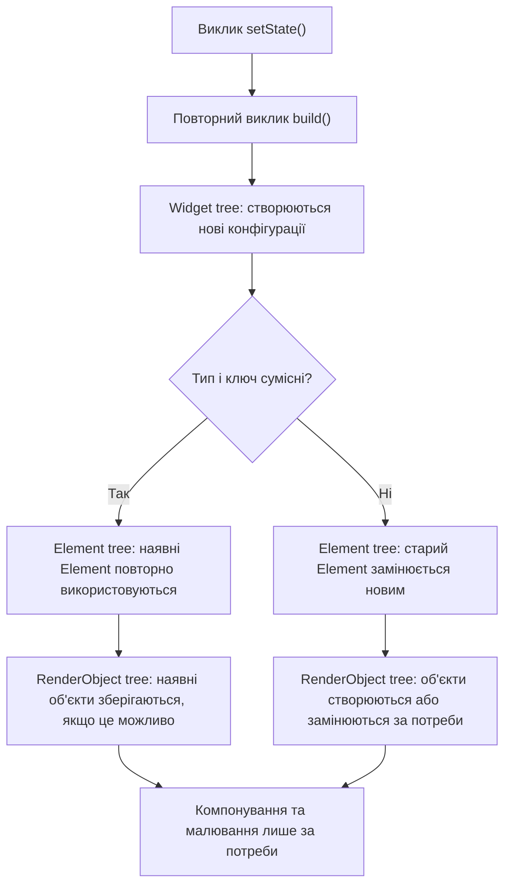
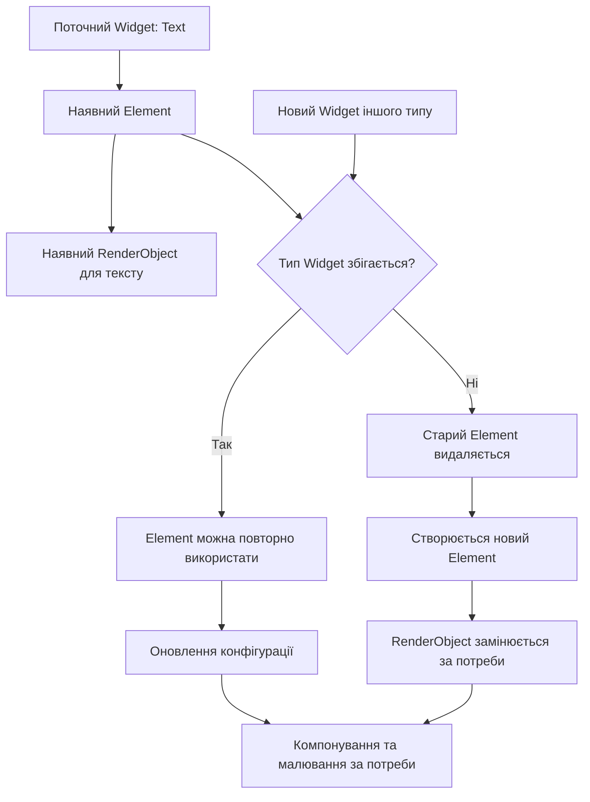

Практична робота №2: Технологія Flutter

Дисципліна: Програмування для мобільних платформ
Тема: Три дерева Flutter
Варіант: 1

1. Мета роботи

Дослідити взаємодію дерев Widget, Element та RenderObject у Flutter, з’ясувати, що відбувається під час перебудови інтерфейсу після виклику setState(), а також визначити умови повторного використання елементів і створення нових об’єктів рендерингу.

2. Вступ

Flutter використовує декларативний підхід до побудови інтерфейсу. Розробник описує бажаний вигляд інтерфейсу за допомогою віджетів, а фреймворк узгоджує цей опис із поточним станом застосунку.

Для цього Flutter використовує три пов’язані структури:

* Widget tree — конфігурація інтерфейсу.
* Element tree — екземпляри, які пов’язують конфігурацію з конкретним місцем у дереві та керують життєвим циклом.
* RenderObject tree — об’єкти, що відповідають за компонування, розміщення та малювання елементів інтерфейсу.

Ці дерева пов’язані між собою, але виконують різні функції.

3. Як працюють три дерева

3.1. Widget tree

Widget описує конфігурацію певної частини інтерфейсу. Віджети зазвичай є незмінними об’єктами. Коли стан змінюється, Flutter може створити нові екземпляри віджетів, які описують оновлений інтерфейс.

3.2. Element tree

Element представляє конкретне розташування віджета в дереві. Під час перебудови Flutter порівнює новий віджет із наявним елементом. Якщо тип і ключ сумісні, Element зазвичай можна повторно використати та оновити його конфігурацію.

3.3. RenderObject tree

RenderObject відповідає за геометрію та відображення інтерфейсу: обробку обмежень, визначення розмірів, розміщення дочірніх об’єктів і малювання.

Не кожен Widget створює окремий RenderObject. Наприклад, Text використовує об’єкти рендерингу для відображення тексту, тоді як деякі віджети лише організовують структуру дерева.

4. Що відбувається після setState()

Розглянемо лічильник, у якому натискання кнопки збільшує число.

1. Користувач натискає кнопку.
2. Викликається setState(), і Flutter позначає відповідну частину інтерфейсу як таку, що потребує перебудови.
3. Метод build() створює нові конфігурації Widget.
4. Flutter узгоджує нові Widget з наявними Element.
5. Якщо тип і ключ віджета сумісні, Element зазвичай зберігається та отримує нову конфігурацію.
6. Якщо зміни впливають на компонування або малювання, відповідні RenderObject оновлюються та виконують необхідну роботу.

Отже, виклик setState() сам по собі не означає, що всі об’єкти всіх трьох дерев будуть створені заново.

5. Діаграма перебудови після setState()



Діаграма показує, що перебудова починається з оновлення стану та створення конфігурацій віджетів. Далі Flutter узгоджує нову конфігурацію з наявною структурою елементів. Обсяг роботи з рендерингом залежить від того, які саме частини інтерфейсу змінилися.

6. Приклад зміни тексту

У прикладі нижче натискання кнопки збільшує лічильник. Значення тексту змінюється, але тип віджета Text залишається тим самим.

```dart
import 'package:flutter/material.dart';

void main() {
  runApp(const MaterialApp(home: CounterPage()));
}

class CounterPage extends StatefulWidget {
  const CounterPage({super.key});

  @override
  State<CounterPage> createState() => _CounterPageState();
}

class _CounterPageState extends State<CounterPage> {
  int count = 0;

  @override
  Widget build(BuildContext context) {
    return Scaffold(
      body: Center(
        child: Column(
          mainAxisSize: MainAxisSize.min,
          children: [
            Text('Лічильник: $count'),
            ElevatedButton(
              onPressed: () => setState(() => count++),
              child: const Text('Збільшити'),
            ),
          ],
        ),
      ),
    );
  }
}
```

Після натискання кнопки Flutter повторно викликає build() для відповідного станового віджета. Створюються нові конфігурації, зокрема Text з оновленим рядком. За сумісності типу та ключа відповідні Element можуть бути повторно використані. Об’єкти рендерингу оновлюються відповідно до зміненого тексту.
Повний приклад коду: [demo/main.dart](demo/main.dart).

7. Що змінюється при зміні типу віджета

Якщо замість одного типу віджета встановити інший, наприклад замінити Text на Icon в тому самому місці дерева, Flutter не може використати той самий Element як елемент нового типу, оскільки типи віджетів не збігаються.

У такому випадку старий Element видаляється, а для нового віджета створюється інший Element. Якщо новий віджет створює RenderObject, старий об’єкт рендерингу більше не відповідає новій конфігурації та може бути замінений новим.

Водночас важливо розрізняти тип Widget і тип RenderObject: новий Widget не завжди означає новий RenderObject. Це залежить від структури віджета та його реалізації.

8. Діаграма зміни типу віджета


    
У цьому випадку зміна типу порушує умову повторного використання Element. Тому Flutter створює новий Element, а RenderObject оновлюється або створюється відповідно до вимог нового віджета.

9. Правило повторного використання Element

Flutter зазвичай повторно використовує Element, коли новий Widget розташований у відповідній позиції дерева та сумісний із попереднім за типом і ключем. Якщо тип або ключ не збігаються, попередній Element не може бути використаний як елемент нової конфігурації, тому Flutter замінює його.

Ключі допомагають Flutter визначати відповідність віджетів, особливо коли діти переміщуються або змінюється їхній порядок. Однак самі ключі не гарантують збереження стану в усіх ситуаціях: результат залежить від типу ключа та структури дерева.

10. Висновок

Під час виконання роботи було з’ясовано, що Widget, Element і RenderObject — це три різні, але взаємопов’язані частини механізму Flutter. Widget описує конфігурацію інтерфейсу, Element підтримує зв’язок між конфігурацією та її місцем у дереві, а RenderObject виконує роботу з компонування та малювання.

Головний висновок полягає в тому, що перебудова інтерфейсу не дорівнює повному перестворенню всіх його внутрішніх об’єктів. Flutter повторно використовує сумісні Element, а роботу з RenderObject виконує відповідно до реальних змін. Це допомагає зрозуміти, чому декларативний підхід не означає, що кожна зміна стану обов’язково призводить до повного перемальовування всього екрана.

11. Джерела

* Flutter Documentation. Inside Flutter. https://docs.flutter.dev/resources/inside-flutter
* Flutter Documentation. Widget class. https://api.flutter.dev/flutter/widgets/Widget-class.html
* Flutter Documentation. Element class. https://api.flutter.dev/flutter/widgets/Element-class.html
* Flutter Documentation. RenderObject class. https://api.flutter.dev/flutter/rendering/RenderObject-class.html
* Flutter Documentation. StatefulWidget class. https://api.flutter.dev/flutter/widgets/StatefulWidget-class.html

Дата звернення до джерел: 22.10.2026.
